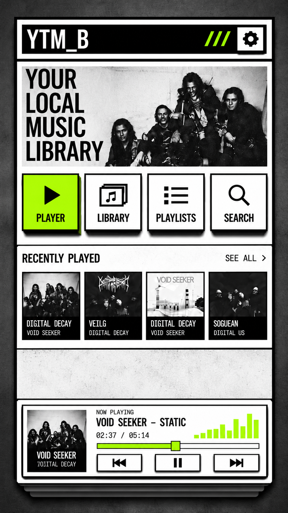
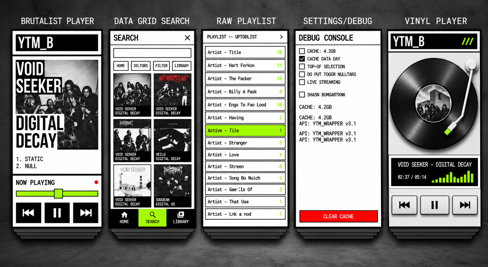

# NeoBrut Player

An Android music player for people who want their local music library to feel like a physical object—not another polished, interchangeable streaming app.

NeoBrut Player is built around the Neo-Brutalist UI/UX concept: bold black-and-white layouts, high-contrast accent colors, hard borders, strong typography, visible controls, and deliberately unapologetic visual structure.

## First release

The first release focuses on being a reliable, fully offline player for music stored on your Android device.

Planned core capabilities include:

- Scanning and browsing local music files
- Artist, album, track, and library views
- Search across the local music library
- Play, pause, seek, previous, and next controls
- Recently played tracks
- Playlist support
- A clear, tactile now-playing experience
- No account, streaming service, or internet connection required for playback

## Design direction

The interface takes inspiration from Neo-Brutalism and physical music hardware: heavy frames, layered panels, oversized controls, raw data grids, and bright accent colors. The goal is to make the player expressive and easy to understand while keeping the music itself central.

## Visual references

The following mockups illustrate the intended visual direction for the first release:

### Home and library

### Interface concepts

## Project status

NeoBrut Player is currently in development. Features and visual details may change as the first release is built and tested.

## License

NeoBrut Player is free and open-source software licensed under the **GNU General Public License v3.0 or later**.

You are free to use, study, modify, and redistribute the project, including creating forks. Distributed modified versions must remain under the GPL and provide the corresponding source code under the license terms.

See the [LICENSE](LICENSE) file for the complete license text.
